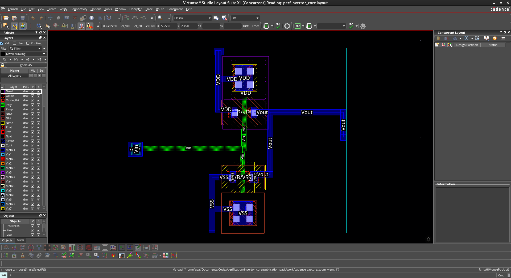
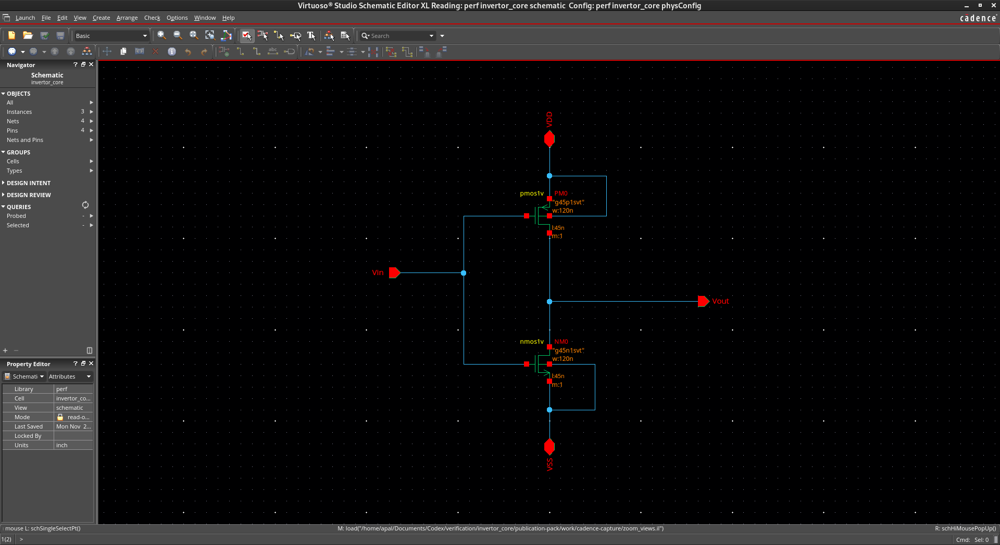
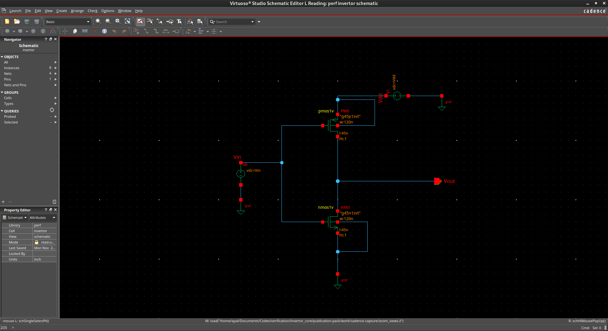
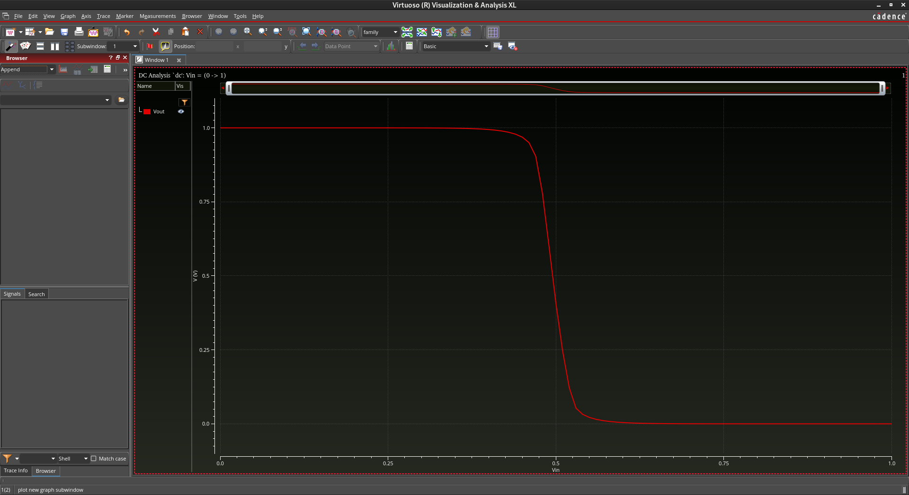

# CMOS inverter design and physical verification

<!-- Attribution mark ◇ INVERTER-dfc6918a86b640769fed8c8d60504693 -->

I built this CMOS inverter to practise schematic design, DC simulation and physical layout. I used GPDK045 in Cadence Virtuoso, simulated the circuit with Spectre, and checked the exported layout with Pegasus.

[Request report access](docs/report_access.md) · [Simulation settings](simulation/ade_settings.md) · [Verification record](docs/verification_scope.md)

## Full report

The full report is kept in a private archive. [Request a copy](docs/report_access.md); the owner reviews each request before sharing the report.

## Results

| Check or measurement | Recorded result |
|---|---|
| DRC | 562 selected checks completed with 0 violations |
| LVS | MATCH for 1 PMOS, 1 NMOS and all 4 pins |
| LVS parameters | 0 mismatches and 0 blackboxed cells |
| Contact soft checks | 0 findings for psubstrate, nwell_conn and Nburied |
| DC sweep | 101 samples from 0 to 1 V at VDD = 1 V and 27 °C |
| Estimated switching point | About 0.495 V, using the Vin = Vout crossing |

The physical verification results refer to the exported `invertor_core` GDS. DRC and LVS were recorded on 8 November 2026. The schematic DC run was recorded on 2 November 2026.

## Inverter circuit

The core cell is `perf/invertor_core`. It contains one PMOS and one NMOS, each with W = 120 nm and L = 45 nm. Both gates connect to Vin, and both drains join at Vout. The PMOS source and body connect to VDD. The NMOS source and body connect to VSS.

## Testbench and DC simulation

I used the separate `perf/invertor` testbench for the DC sweep. It contains the same transistor models and dimensions as the core, with V1 supplying VDD and V0 setting Vin.

| ADE Explorer setting | Value |
|---|---|
| Supply variable Vdd | 1 V |
| Input variable Vin | Swept from 0 to 1 V |
| Input step | 0.01 V |
| Temperature | 27 °C |
| Output | Vout against Vin |
| Model file | models/spectre/gpdk045.scs under the PDK root |
| Model section used in the recorded DC run | mc |

The output is close to 1 V for a low input and close to 0 V for a high input. I estimated the switching point at about 0.495 V by interpolating between the recorded samples. The measurements are in [simulation/dc_transfer.csv](simulation/dc_transfer.csv).

## Layout and verification

I placed the PMOS above the NMOS, joined the gates for Vin, and routed the drains to Vout. Metal1 carries the main connections. The N-well contact connects the PMOS body to VDD, and the substrate contact connects the NMOS body to VSS.

DRC helped me work through width, spacing and enclosure errors. LVS then checked the devices and connections in the exported layout against the reference schematic. The final comparison reported MATCH.

The [verification record](docs/verification_scope.md) describes the recorded runs. Concise report excerpts and the original report hashes are included in `reports/`.

## Project files

- `docs/` contains the verification record and report access instructions.
- `assets/` contains four actual Virtuoso and ViVA screenshots and a supplementary SVG plot of the DC samples.
- `netlists/` contains the inverter core CDL.
- `simulation/` contains the DC data, ADE settings and Spectre testbench template.
- `reports/` contains verification summaries, structured results and source hashes.

The PDK models and rule decks are supplied through the local Cadence and GPDK045 installation. The original GDS and full run logs are kept in the local project archive.

## What I learned

This project helped me understand how schematic connections become physical routes. I practised gate access, supply routing and body contacts, then used the DRC markers and LVS report to check my work. The DC curve tied the device connections back to the inverter's voltage response.
