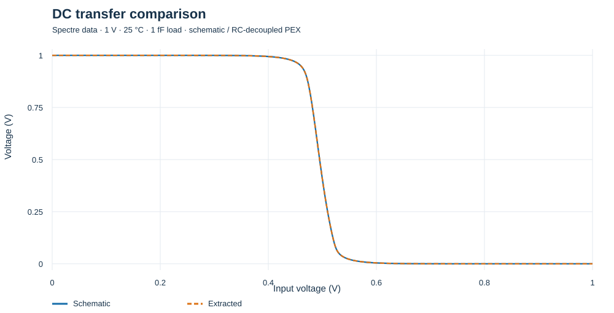
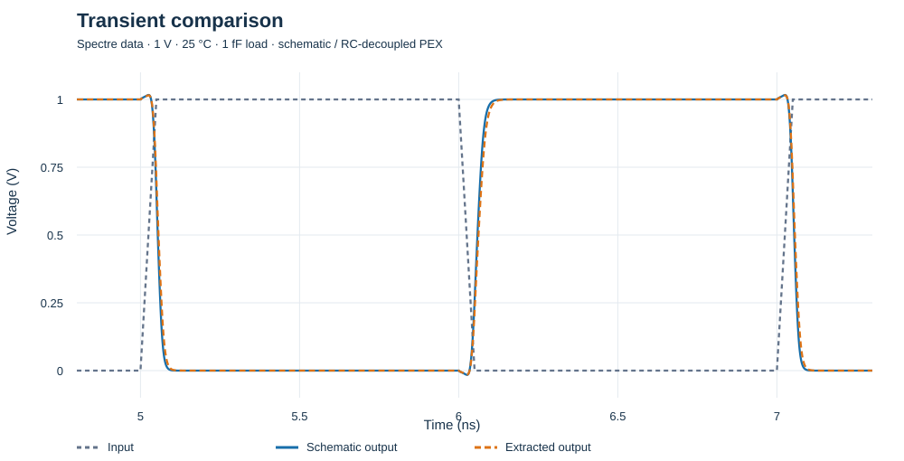
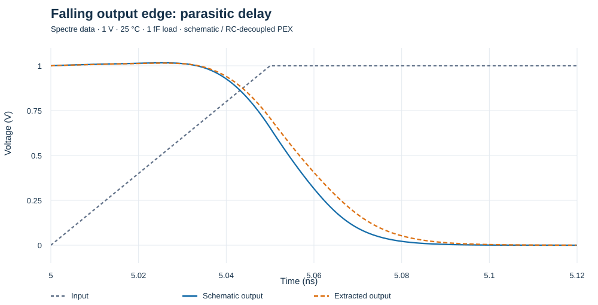
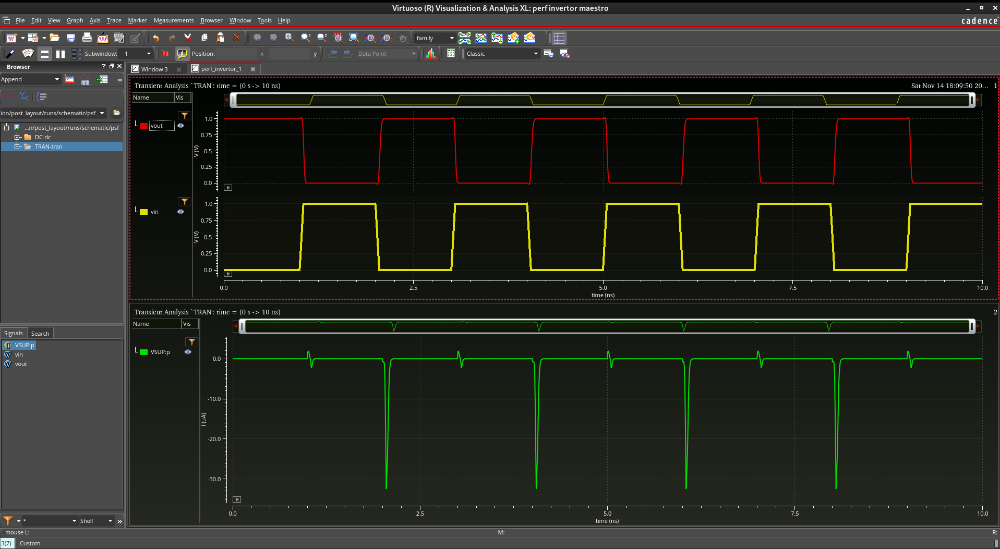

# Post-layout results and project completion

Completed on 14 November 2026. I finished the practice scope: schematic design, DC characterization, custom layout, the recorded DRC/LVS checks, Quantus RC extraction and schematic-versus-extracted DC/transient comparison.

## Measured results

| Measurement | Schematic | Extracted |
|---|---:|---:|
| Switching voltage (V) | 0.495219 | 0.495220 |
| Low noise margin (V) | 0.4195 | 0.4195 |
| High noise margin (V) | 0.4290 | 0.4290 |
| High-to-low delay (ps) | 29.27 | 31.69 |
| Low-to-high delay (ps) | 33.98 | 37.19 |
| Average propagation delay (ps) | 31.62 | 34.44 |
| Output rise time (10–90%) (ps) | 37.53 | 43.25 |
| Output fall time (90–10%) (ps) | 28.19 | 32.30 |
| Average supply power (µW) | 0.599 | 0.692 |

The average propagation delay increased by **8.90%** under this test load. The DC curves remain almost coincident. The results show the dynamic cost of the physical implementation; they do not imply that every possible load or corner has been characterized.

These plots are generated from the saved Spectre samples. They are supplementary data plots, not screenshots of ViVA. The original Virtuoso/ViVA screenshots remain in the main project.

## Actual ViVA schematic transient screenshot

Captured from the schematic `simulation/post_layout/runs/schematic/psf` database. The upper pane shows vout (red) and vin (yellow); the lower pane shows VSUP:p supply current (green, microamperes). This image shows the schematic run only, not an overlay with the extracted result. Negative supply-source current follows the source terminal reference direction and indicates current delivered by the supply during charging.

## Test conditions and measurement definitions

Both circuits used VDD = 1 V, VSS = 0 V, 25 °C, the same GPDK045 model section `mc`, and a 1 fF external output load. The model section name does not denote a Monte Carlo run. The earlier archived DC test was at 27 °C; these new paired measurements are both at 25 °C to match the PEX setting.

DC: 0–1 V in 0.5 mV steps (2001 samples). VM is the linearly interpolated Vin = Vout crossing. Noise margins use the two slope = -1 boundaries, with VOH = Vout(VIL) and VOL = Vout(VIH).

Transient: 0–1 V pulse, 1 ns initial delay, 50 ps rise/fall, 950 ps high plateau, 2 ns period and 10 ns stop. Propagation delays use corresponding 50% input/output crossings. Output slew uses 10–90% and 90–10%. Timing averages use settled edges after 3 ns and before 9 ns. Average supply power integrates -VDD × I(VSUP:p) over 5–9 ns, including load charging and device supply current; it excludes power delivered by the input voltage source.

Final maximum timestep was 1 ps. Tightening from 2 ps and reducing the DC step from 1 mV to 0.5 mV changed every reported timing metric by less than 0.08%. The final runs completed with zero errors and zero warnings. Spectre conservative mode used Gear2; its effective transient reltol was 1e-7 in the final run (the options reltol was 1e-6).

## Extraction and device-property checks

Quantus 25.1.0-p047 completed RC-decoupled extraction: 11 parasitic resistors, 12 parasitic capacitors, four LVS nets and zero reported floating nets. Both SPICE output and the `av_extracted_rc` graphical view completed normally. Post-layout simulation used the SPICE subcircuit, not the graphical view.

The extracted netlist retains one `g45n1svt` and one `g45p1svt`, W = 120 nm and L = 45 nm, with body nodes VSS and VDD. Its external pin order is VDD VSS Vin Vout. Two exported `fw` parameters duplicated the width but were unsupported by the Spectre subcircuit wrappers; they were removed from the simulation copy. W/L, connectivity and all R/C values were retained. The raw export is preserved locally.

The schematic baseline retains the archived source transistor parameters. The extracted version retains layout-derived `sca/scb/scc` and other exported geometry values; omitted parameters use PDK defaults. The comparison therefore includes layout-derived device parameter differences as well as interconnect RC, rather than isolating wire RC alone. Quantus warned that a `.props` file was absent; recognized model names, W/L, bodies and exported geometry were checked, but complete arbitrary source-property transfer is not claimed. RC decoupled means coupling capacitance is represented against the reference node, rather than retained as a full coupled network.

## Completion evidence

- Earlier Pegasus DRC: 562 selected checks, zero violations.
- Earlier Pegasus LVS: MATCH, two devices, four matching pins, zero parameter mismatches.
- Named body-contact soft checks: zero findings; standalone general ERC executed zero checks.
- Quantus SPICE and extracted-view output: normal termination on 14 November 2026.
- Schematic and extracted Spectre DC/transient: normal completion, zero errors/warnings after compatibility cleanup.
- Timestep/DC-step convergence comparison: saved in `reports/post_layout_results.json`.

The extraction input was the saved Pegasus `manual-001` database. The results apply to that verified export, not to unsaved or later layout edits. The practice project is complete at this scope; it is not a fabrication/tapeout certification or an all-corner characterization.

## Files

`simulation/post_layout/` contains complete sampled DC/transient CSV files and portable Spectre decks. `netlists/invertor_core_pex.sp` contains the simulation-compatible extracted subcircuit. `reports/post_layout_results.json` records measurements and convergence comparisons. See [manual run instructions](../simulation/post_layout/README.md).
